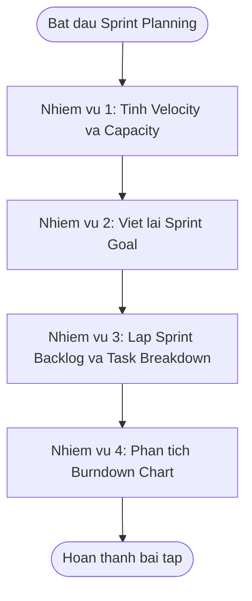

# BÁO CÁO BÀI TẬP: LẬP KẾ HOẠCH SPRINT CHO HỆ THỐNG ĐẶT LỊCH SẠC XE MÁY ĐIỆN

> 👤 **Học viên:** Hoàng Công Dũng | **Mã SV:** PTIT-HCM-009
> 🏫 **Môn học:** it206-k25-HoangCongDung

---

## 📊 Sơ đồ thiết kế hệ thống (Flowchart)

> 💡 *Sơ đồ dưới đây được render tự động trực tiếp trên GitHub bằng Mermaid. Bạn cũng có thể tải file **`bt2.drawio`** trong repository này để mở và chỉnh sửa trực tiếp trên [Draw.io (diagrams.net)](https://app.diagrams.net).* 

---

## Nhiệm vụ 1 - Phân tích Velocity và Capacity

Dưới đây là phần tính toán và điền số liệu vào các bảng dữ liệu cho Sprint hiện tại của RikkeiCharge.

Velocity tham khảo được tính bằng trung bình cộng số SP hoàn thành của 3 Sprint trước: (15 + 16 + 17) / 3 = 16 SP. Cách dùng: Dùng làm mức định hướng để dự báo khối lượng PBI nhóm có thể kéo vào Sprint, không phải là cam kết cứng nhắc.

| Sprint | SP hoàn thành (Done) | Ghi chú |
| --- | --- | --- |
| Sprint -3 | 15 | Đủ thành viên |
| Sprint -2 | 16 | Đủ thành viên |
| Sprint -1 | 17 | Đủ thành viên |
| Velocity tham khảo | 16 SP | Trung bình 3 Sprint trước, dùng để định hướng tải công việc |

## Bảng Capacity chi tiết của Sprint

Tính toán capacity dựa trên số ngày khả dụng thực tế của từng Developer nhân với số giờ tập trung mỗi ngày (5 giờ/ngày). Dev C nghỉ 2 ngày nên số ngày khả dụng là 8 ngày, capacity tương ứng là 40 giờ.

| Developers | Ngày Sprint | Ngày không tham gia | Ngày khả dụng | Giờ tập trung/ngày | Capacity (giờ) |
| --- | --- | --- | --- | --- | --- |
| Dev A | 10 | 0 | 10 | 5 | 50 |
| Dev B | 10 | 0 | 10 | 5 | 50 |
| Dev C | 10 | 2 | 8 | 5 | 40 |
| Dev D | 10 | 0 | 10 | 5 | 50 |
| Tổng | - | - | - | - | 190 giờ |

## Nhận xét nhiệm vụ 1

Nhận xét: Capacity Sprint này là 190 giờ, thấp hơn mức chuẩn 200 giờ do Dev C nghỉ 2 ngày. Kết hợp Velocity tham khảo là 16 SP và Capacity 190 giờ, nhóm có thể tự tin chọn các PBI có tổng khoảng 11-14 SP để đảm bảo hoàn thành tốt mà không bị quá tải.

## Nhiệm vụ 2 - Viết lại Sprint Goal

Sprint Goal đã chỉnh sửa: Giúp người dùng dễ dàng tìm kiếm trạm sạc, kiểm tra khung giờ trống và đặt lịch giữ chỗ trước một cách nhanh chóng, tiện lợi.

## Nhiệm vụ 3 - Lập Sprint Backlog

Dưới đây là bảng đánh giá chọn PBI cho Sprint và danh sách các Task phân rã cho CS03.

| Mã Story | Ưu tiên | SP | Chọn/Chưa chọn | Lý do |
| --- | --- | --- | --- | --- |
| CS01 | 1 | 3 | ☑ Chọn ☐ Chưa | Ưu tiên 1; bước đầu để người dùng tìm trạm. |
| CS02 | 2 | 3 | ☑ Chọn ☐ Chưa | Ưu tiên 2; cần biết giờ còn trống trước khi đặt. |
| CS03 | 3 | 5 | ☑ Chọn ☐ Chưa | Ưu tiên 3; cốt lõi của tính năng đặt lịch sạc trước, phù hợp với capacity. |
| CS04 | 4 | 5 | ☐ Chọn ☐ Chưa | Chưa chốt quy tắc nghiệp vụ hủy sát giờ và capacity giới hạn 190 giờ nên để lại Sprint sau. |
| Tổng SP đã chọn | 11 SP |  | Mức dự báo, không phải cam kết |  |

## Task Breakdown cho CS03

Phân rã User Story CS03 thành các công việc kỹ thuật cụ thể cho các lập trình viên thực hiện:

| STT | Task | Đầu ra | Ước lượng (giờ) |
| --- | --- | --- | --- |
| 1 | Thiết kế API đặt lịch và ràng buộc không trùng giờ sạc tại một vị trí | API Backend endpoint POST /api/bookings thành công | 16 |
| 2 | Xây dựng giao diện chọn trạm, chọn giờ, chọn xe và sinh mã xác nhận | UI Screen chọn lịch và hiển thị mã QR/Code xác nhận | 14 |

## Nhiệm vụ 4 - Phân tích Burndown Chart

1. So sánh đường thực tế với đường lý tưởng: Từ ngày 0 đến ngày 7, đường thực tế đi ngang ở mức 11 SP (không có PBI nào hoàn thành), trong khi đường lý tưởng giảm đều đặn. Dấu hiệu bất thường này cho thấy nhóm đang gặp tắc nghẽn nghiêm trọng (bottleneck), có nguy cơ trễ Sprint Goal nếu các PBI không được đưa về trạng thái Done sớm.

2. Đề xuất hành động tại Daily Scrum ngày 7: Nhóm cần lập tức hội ý để xác định nguyên nhân nghẽn (ví dụ đang kẹt ở khâu kiểm thử hoặc viết API), tiến hành chia nhỏ task hoặc huy động dev hỗ trợ chéo nhằm hoàn thành gấp CS01 và CS02 trước ngày 8, đồng thời kiên quyết không nhận thêm việc mới ngoài Sprint Goal.

---

## 📁 Danh sách tệp tin nộp bài trong Repository
- 📝 `bt2.docx`: Báo cáo tài liệu phân tích nghiệp vụ hoàn chỉnh.
- 🎨 `bt2.drawio`: File thiết kế sơ đồ chuẩn theo quy định đề bài (mở trực tiếp bằng [Draw.io](https://app.diagrams.net) hoặc Lucidchart).
